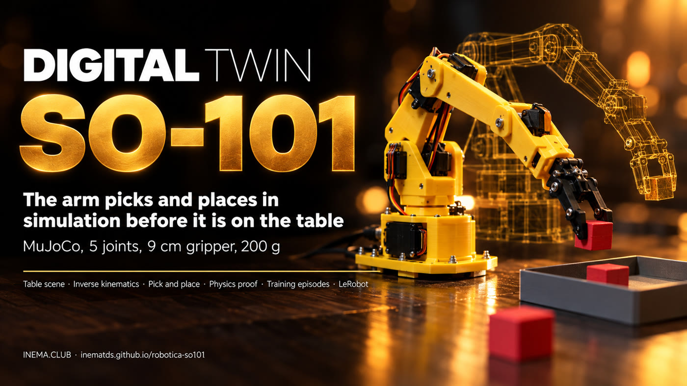

# robotica-so101

[](https://inematds.github.io/robotica-so101/guia/en/)

**🇧🇷 [Português](README.md) · 🇺🇸 [English](README.en.md) · 🇪🇸 [Español](README.es.md)**

## What it is

It is a virtual copy (a "twin") of the SO-101 robotic arm, the low-cost 5-joint kit used with LeRobot, running in the MuJoCo physics simulator. It is for anyone who is going to build the arm and wants to test first: the twin picks up a cube, a tennis ball and a small pot and puts them in a tray, records the movements as training data and shows whether a plan works. All you need is a computer with Linux and Python; the real arm comes in the later phases.

## 📖 User guide

Full guide (landing + step by step): **https://inematds.github.io/robotica-so101/guia/en/**

Simulation twin of the **SO-101** arm (Hiwonder SO-ARM101 kit, LeRobot) and the path to the real arm.
It continues [robotica-real2sim](https://github.com/inematds/robotica-real2sim), which does the same
with a simulated Franka Panda: photo of the table → MuJoCo twin → episodes → plan proven in physics. Here
the twin becomes the arm that will actually be on the table.

**Status (15/10/2026): Phase 0 done.** The SO-101 twin picks up and drops light objects in simulation:
a 3 cm cube, a tennis ball and a 4 cm pot, each 50/50 episodes into the tray; all three together
in one plan pass the test. Next: Phase 1 (real table measured with a tape measure, without powering any motor).

## Why a separate project

The SO-101 is a different class of arm: ~40 cm reach and 200 g payload, versus ~85 cm and 3 kg for the Panda.
The model, the kinematics (5 joints instead of 7), the gripper, the table and the objects all change. Kept separate, one does not break
the other.

## The arm

| Item | Value |
|---|---|
| Kit | Hiwonder SO-ARM101: leader + follower arm, 12 servos |
| Servos | Hiwonder HX-30HM and HX-10HM, bus servos, 12 V (leader at 5 V) |
| Payload | 200 g |
| Reach | 400 mm (manufacturer); ~468 mm in the MuJoCo model |
| Gripper | opens up to ~13 cm in the model |
| Cameras | wrist + external |

## Roadmap

Full plan in [docs/PLANO.md](docs/PLANO.md) (in Portuguese):

0. SO-101 twin in the simulator (without the arm)
1. Real table measured with a tape measure (without powering any motor)
2. Assemble, power on and calibrate
3. Compare twin and arm
4. Camera gives the position (ArUco markers)
5. First physical test
6. Training with LeRobot (real + simulated data)
7. Publish

## Install and run

```bash
./instalar.sh                                                   # venv with MuJoCo + SO-101 model
python3 testes/rodar.py                                         # tests (~3 min) -> TUDO OK
./r2s.py episodios exemplos/mesa-so101/cena.json /tmp/ep -n 50  # training data -> 50/50
./r2s.py filmar exemplos/mesa-so101/cena.json /tmp/so101.mp4 --cameras geral,cima,pulso
.venv/bin/python ferramentas/matriz_prova.py                    # cross test: measured, ±15%, worst case
```

## Exercises for the booth: discover, tidy up, obey

Three activities for the booth, guided by an overhead camera (details in
[`exercicios/README.md`](exercicios/README.md)); measured on the twin on 10/19/2026:

| Exercise | What it does | Measured |
|---|---|---|
| `./r2s.py descobrir` | finds the odd piece out (different color or shape), announces it, puts it away, and celebrates | 20/20 |
| `./r2s.py arrumar` | cleanup order: everything outside the box goes into the box, checked by the camera | 20/20 clean tables |
| `./r2s.py obedecer` | "pick up the red cube", "where is the blue ball?", "tidy up the table", "say goodbye" | 11/11 phrases |

Note: the robot currently understands Brazilian Portuguese only.

Vision: average error of 1.1 mm against the physics, color and shape 70/70. Everything runs locally (no API); voice is optional
with local Whisper (`./instalar.sh --voz`) and Piper.

## What the SO-101 twin knows (Phase 0)

- Gripper straight down from 15 to 30 cm from the base, up to ~8 cm high; higher or farther, it tilts.
- Grasps by pressing the object against the fixed finger (the SO-101 gripper has one stationary finger and one that rotates).
- Carries the object around the others on the table and passes only ~1.5 cm above the tray rim.
- Objects going to the same tray get slots based on the size of each one.
- Not yet: laying a tall can down in a shallow tray (exists in the Panda project).

License: MIT (code). The SO-101 model comes from MuJoCo Menagerie (Apache-2.0).
