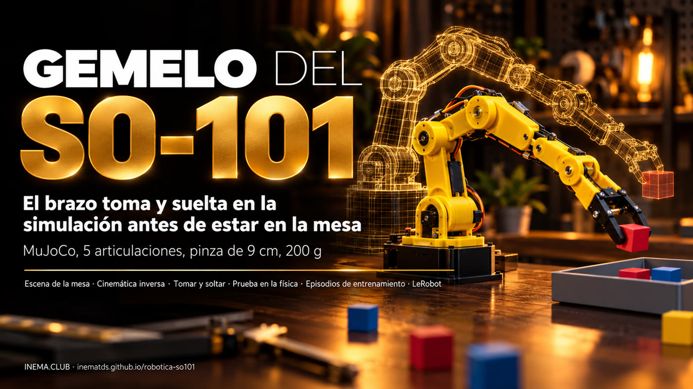

# robotica-so101

[](https://inematds.github.io/robotica-so101/guia/es/)

**🇧🇷 [Português](README.md) · 🇺🇸 [English](README.en.md) · 🇪🇸 [Español](README.es.md)**

## Qué es

Es una copia virtual (un "gemelo") del brazo robótico SO-101, el kit económico de 5 articulaciones que se usa con LeRobot, funcionando en el simulador de física MuJoCo. Sirve para quien va a armar el brazo y quiere probar antes: el gemelo toma un cubo, una pelota de tenis y un frasquito y los pone en una bandeja, graba los movimientos como datos de entrenamiento y muestra si un plan funciona. Solo necesita una computadora con Linux y Python; el brazo real entra en las fases siguientes.

## 📖 Guía de uso

Guía completa (landing + paso a paso): **https://inematds.github.io/robotica-so101/guia/es/**

Gemelo de simulación del brazo **SO-101** (kit Hiwonder SO-ARM101, LeRobot) y el camino hasta el brazo real.
Es la continuación de [robotica-real2sim](https://github.com/inematds/robotica-real2sim), que hace lo mismo
con un Franka Panda simulado: foto de la mesa → gemelo MuJoCo → episodios → plan probado en la física. Aquí
el gemelo pasa a ser el brazo que va a estar en la mesa de verdad.

**Estado (15/10/2026): Fase 0 terminada.** El gemelo del SO-101 toma y suelta objetos livianos en la simulación:
cubo de 3 cm, pelota de tenis y frasquito de 4 cm, cada uno 50/50 episodios en la bandeja; los tres juntos
en un plan pasan la prueba. Siguiente: Fase 1 (mesa real medida con cinta métrica, sin encender motores).

## Por qué un proyecto separado

El SO-101 es otra clase de brazo: ~40 cm de alcance y 200 g de carga, frente a ~85 cm y 3 kg del Panda.
Cambian el modelo, la cinemática (5 articulaciones en lugar de 7), la pinza, la mesa y los objetos. Separados, uno no
rompe al otro.

## El brazo

| Ítem | Valor |
|---|---|
| Kit | Hiwonder SO-ARM101: brazo líder + seguidor, 12 servos |
| Servos | Hiwonder HX-30HM y HX-10HM, de bus, 12 V (líder en 5 V) |
| Carga | 200 g |
| Alcance | 400 mm (fabricante); ~468 mm en el modelo MuJoCo |
| Pinza | abre hasta ~13 cm en el modelo |
| Cámaras | muñeca + externa |

## Hoja de ruta

Plan completo en [docs/PLANO.md](docs/PLANO.md) (en portugués):

0. Gemelo del SO-101 en el simulador (sin el brazo)
1. Mesa real medida con cinta métrica (sin encender motores)
2. Armar, encender y calibrar
3. Comparar gemelo y brazo
4. La cámara da la posición (marcadores ArUco)
5. Primera prueba física
6. Entrenamiento con LeRobot (datos reales + simulados)
7. Publicar

## Instalar y ejecutar

```bash
./instalar.sh                                                   # venv con MuJoCo + modelo del SO-101
python3 testes/rodar.py                                         # pruebas (~3 min) -> TUDO OK
./r2s.py episodios exemplos/mesa-so101/cena.json /tmp/ep -n 50  # datos de entrenamiento -> 50/50
./r2s.py filmar exemplos/mesa-so101/cena.json /tmp/so101.mp4 --cameras geral,cima,pulso
.venv/bin/python ferramentas/matriz_prova.py                    # prueba cruzada: medida, ±15%, peor caso
```

## Lo que sabe el gemelo del SO-101 (Fase 0)

- Pinza recta hacia abajo de 15 a 30 cm de la base, hasta ~8 cm de altura; más alto o más lejos, se inclina.
- Toma apoyando el objeto en el dedo fijo (la pinza del SO-101 tiene un dedo quieto y uno que gira).
- Lleva el objeto rodeando los demás de la mesa y pasa solo ~1,5 cm por encima del borde de la bandeja.
- Los objetos que van a la misma bandeja reciben lugares según el tamaño de cada uno.
- Todavía no: acostar una lata alta en una bandeja baja (existe en el Panda).

Licencia: MIT (código). El modelo del SO-101 viene de MuJoCo Menagerie (Apache-2.0).
