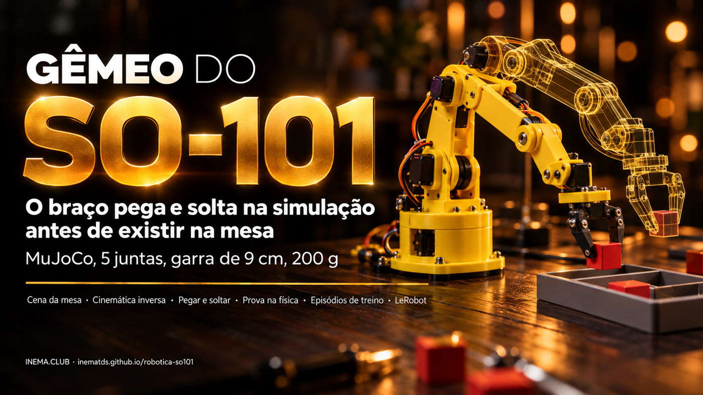

# robotica-so101

[](https://inematds.github.io/robotica-so101/guia/)

**🇧🇷 [Português](README.md) · 🇺🇸 [English](README.en.md) · 🇪🇸 [Español](README.es.md)**

## O que é

É uma cópia virtual (um "gêmeo") do braço robótico SO-101, o kit barato de 5 juntas usado com o LeRobot, rodando no simulador de física MuJoCo. Serve para quem vai montar o braço e quer testar antes: o gêmeo pega um cubo, uma bola de tênis e um potinho e põe numa bandeja, grava os movimentos como dados de treino e mostra se um plano funciona. Precisa só de um computador com Linux e Python; o braço de verdade entra nas fases seguintes.

## 📖 Guia de uso

Guia completo (landing + passo a passo): **https://inematds.github.io/robotica-so101/guia/**

Gêmeo de simulação do braço **SO-101** (kit Hiwonder SO-ARM101, LeRobot) e o caminho até o braço real.
É a continuação do [robotica-real2sim](https://github.com/inematds/robotica-real2sim), que faz o mesmo
com um Franka Panda simulado: foto da mesa → gêmeo MuJoCo → episódios → plano provado na física. Aqui
o gêmeo passa a ser o braço que vai estar na mesa de verdade.

**Estado (15/10/2026): Fase 0 feita.** O gêmeo do SO-101 pega e solta objetos leves na simulação:
cubo de 3 cm, bola de tênis e potinho de 4 cm, cada um 50/50 episódios na bandeja; os três juntos
num plano passam na prova. Próxima: Fase 1 (mesa real medida com fita métrica, sem ligar motor).

## Por que um projeto separado

O SO-101 é outra classe de braço: ~40 cm de alcance e 200 g de carga, contra ~85 cm e 3 kg do Panda.
Mudam o modelo, a cinemática (5 juntas em vez de 7), a garra, a mesa e os objetos. Separado, um não quebra
o outro.

## O braço

| Item | Valor |
|---|---|
| Kit | Hiwonder SO-ARM101: braço líder + seguidor, 12 servos |
| Servos | Hiwonder HX-30HM e HX-10HM, de barramento, 12 V (líder em 5 V) |
| Carga | 200 g |
| Alcance | 400 mm (fabricante); ~468 mm no modelo MuJoCo |
| Garra | abre até ~13 cm no modelo |
| Câmeras | pulso + externa |

## Roteiro

Plano completo em [docs/PLANO.md](docs/PLANO.md):

0. Gêmeo do SO-101 no simulador (sem o braço)
1. Mesa real medida com fita métrica (sem ligar motor)
2. Montar, ligar e calibrar
3. Comparar gêmeo e braço
4. Câmera dá a posição (marcadores ArUco)
5. Primeira prova física
6. Treino com LeRobot (dados reais + simulados)
7. Publicar

## Instalar e rodar

```bash
./instalar.sh                                                   # venv com MuJoCo + modelo do SO-101
python3 testes/rodar.py                                         # testes (~3 min) -> TUDO OK
./r2s.py episodios exemplos/mesa-so101/cena.json /tmp/ep -n 50  # dados de treino -> 50/50
./r2s.py filmar exemplos/mesa-so101/cena.json /tmp/so101.mp4 --cameras geral,cima,pulso
.venv/bin/python ferramentas/matriz_prova.py                    # prova cruzada: medida, ±15%, pior caso
```

## O que o gêmeo do SO-101 sabe (Fase 0)

- Garra reto para baixo de 15 a 30 cm da base, até ~8 cm de altura; mais alto ou mais longe, inclina.
- Pega encostando o objeto no dedo fixo (a garra do SO-101 tem um dedo parado e um que gira).
- Leva o objeto contornando os outros da mesa e passa só ~1,5 cm acima da borda da bandeja.
- Objetos que vão para a mesma bandeja ganham vagas pelo tamanho de cada um.
- Ainda não: deitar lata alta em bandeja rasa (existe no Panda).

Licença: MIT (código). O modelo do SO-101 vem do MuJoCo Menagerie (Apache-2.0).
